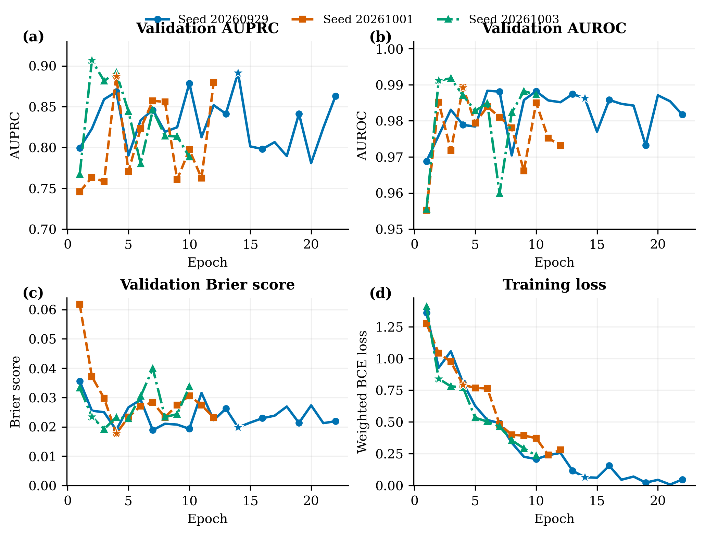

# B2 双眼 CFP 基线三随机种子正式报告 v1

日期：2026-10-12  
任务：患者级可转诊糖尿病视网膜病变（rDR）二分类  
阳性定义：患者级 ICDR ≥ 2  
报告性质：BRSET 开发集基线验证，非内部或外部测试结果

## 1. 结论摘要

B2 以 ImageNet 预训练 ConvNeXt-Tiny 作为共享眼别图像编码器，仅使用双眼 CFP，不使用临床表格信息。三个预注册随机种子在完全相同的冻结配置下完成训练，均正常早停并产生可回读的最佳检查点。

三种子开发集结果为：

- AUROC：**0.9889 ± 0.0025**；
- AUPRC：**0.8952 ± 0.0103**；
- Brier score：**0.0203 ± 0.0029**。

结果支持将 B2 冻结为后续多模态实验的图像基线。但本报告的指标均来自用于早停和模型选择的 validation，不得解读为最终泛化性能或临床效能。

## 2. 数据与实验单位

| 项目 | Train | Validation |
|---|---:|---:|
| 患者数 | 4,326 | 618 |
| rDR 阳性患者 | 283 | 40 |
| rDR 患病率 | 6.54% | 6.47% |
| CFP 图像数 | 8,670 | 1,236 |

- 分析单位为患者，不是单张图像；
- 训练、验证使用已冻结的患者级划分；
- 图像使用 `fundus_512_v1` 预处理；
- BRSET internal test 和 mBRSET 未被访问；
- 患者 manifest SHA-256：`1e8b6e135c3cdb7e7d1840d5ac7ccb9dc4039656eb410a26921c53535f8341b3`；
- 图像 manifest SHA-256：`dacc4a0d5bae150caca3301f01238f6751e93fb3464c415e2122083c982529c7`。

## 3. B2 模型与冻结训练配置

| 组件 | 配置 |
|---|---|
| 输入模态 | 双眼 CFP，无临床表格输入 |
| 编码器 | ImageNet 预训练 ConvNeXt-Tiny，端到端微调 |
| 眼别编码 | 左右眼共享参数，无跨眼特征交互 |
| 视图聚合 | `masked_mean` |
| 患者级聚合 | `max_logit` |
| Dropout | 0.20 |
| Optimizer | AdamW，LR 1×10⁻⁴，weight decay 0.05 |
| Scheduler | 5% warmup＋cosine decay |
| Batch | micro-batch 8，梯度累积 2，等效 batch 16 |
| 精度 | BF16 |
| 梯度裁剪 | max norm 1.0 |
| 最大 epoch | 30 |
| 选择指标 | validation AUPRC |
| 早停 | patience 8，minimum delta 0.0001 |
| 确定性 | PyTorch deterministic，`CUBLAS_WORKSPACE_CONFIG=:4096:8` |

三次运行除随机种子与物理 GPU 标识外，其余解析后配置完全相同。

## 4. 三随机种子结果

| Seed | GPU | 完成 epoch | 最佳 epoch | AUROC | AUPRC | Brier | Sensitivity@0.5 | Specificity@0.5 | PPV@0.5 | NPV@0.5 |
|---:|---:|---:|---:|---:|---:|---:|---:|---:|---:|---:|
| 20260929 | 0 | 22 | 14 | 0.9862 | 0.8916 | 0.0198 | 0.775 | 0.993 | 0.886 | 0.985 |
| 20261001 | 0 | 12 | 4 | 0.9893 | 0.8872 | 0.0177 | 0.825 | 0.991 | 0.868 | 0.988 |
| 20261003 | 1 | 10 | 2 | 0.9912 | 0.9068 | 0.0235 | 0.875 | 0.972 | 0.686 | 0.991 |

`Sensitivity@0.5`、`Specificity@0.5`、`PPV@0.5` 和 `NPV@0.5` 仅使用开发阶段固定阈值 0.5，用于监测而不是预注册临床工作点。各种子最佳检查点均按各自 validation AUPRC 独立选择。

## 5. 汇总与稳定性

| 指标 | 均值 ± 样本标准差 | 范围 |
|---|---:|---:|
| AUROC | 0.9889 ± 0.0025 | 0.9862–0.9912 |
| AUPRC | 0.8952 ± 0.0103 | 0.8872–0.9068 |
| Brier | 0.0203 ± 0.0029 | 0.0177–0.0235 |

报告中的“±”为三个种子间的样本标准差（`ddof=1`），不是患者级置信区间。AUPRC 标准差约为 0.0103，说明随机初始化与数据顺序会产生可观测但总体较小的变化。患者级 bootstrap 95% 置信区间将在模型、校准和阈值全部冻结后，针对锁定测试集计算。

## 6. 学习曲线

**Figure 1.** B2 双眼 CFP 基线的三随机种子开发集学习曲线。星号表示各随机种子按 validation AUPRC 选定的最佳 epoch，并在其余面板标出同一 epoch 的值。不同曲线长度由早停决定。

三个种子的训练 loss 均持续下降，但 validation AUPRC 存在明显的 epoch 间波动，最佳 epoch 分别为 14、4 和 2。这与 validation 仅含 40 名阳性患者的情况一致：少量患者排序改变即可影响 PR 曲线。因此，早停和三种子汇总均是必要的，不应挑选单个最高种子作为主结果。

## 7. 运行效率

| Seed | 耗时 | Peak allocated | Peak reserved |
|---:|---:|---:|---:|
| 20260929 | 43.59 min | 6.35 GiB | 8.64 GiB |
| 20261001 | 23.85 min | 6.24 GiB | 8.64 GiB |
| 20261003 | 22.93 min | 6.24 GiB | 8.64 GiB |

耗时差异主要来自早停 epoch 数不同。三次运行均无 OOM、NaN 或数据读取错误。

## 8. 审计结果

- 三次运行均以 `status=complete` 退出；
- 每个 validation 预测文件均含 618 名唯一患者、40 名阳性患者，无重复患者；
- 三个最佳检查点均可成功回读，检查点 epoch 和最佳 AUPRC 与 `summary.json` 一致；
- 每个最佳检查点大小为 334,039,214 bytes；
- 所有逐 epoch 核心指标均为有限数，未发现 NaN 或 Inf；
- 数据 manifest 哈希在三次运行中完全一致；
- 除随机种子和物理 GPU 标识外，冻结配置一致；
- internal test 和 mBRSET 仍未解锁。

## 9. 解读与限制

1. B2 在三个种子上均取得高 AUPRC，证明双眼 CFP 含有强 rDR 判别信息，训练链路具有重复性。
2. 固定阈值 0.5 下，seed 20261003 虽然 AUPRC 最高，但 PPV 仅为 0.686；这说明排序性能与固定阈值性能不可混为一谈，后续需要独立的概率校准和工作点锁定。
3. 最佳 epoch 在 2–14 之间变动，反映了小阳性验证集上 PR 指标的方差；这不构成更改 patience 或强制训满 30 epochs 的依据。
4. 本报告没有测试集结果、患者级 bootstrap 置信区间、校准斜率/截距或预注册高敏感度工作点；这些应在多模态方案完成并冻结后统一评估。
5. B2 是“共享编码器＋患者级聚合”基线，不对左右眼不对称特征进行显式建模，也不使用临床信息。

## 10. 实验决策

- **B2 状态：冻结。** 不再为 B2 调整超参数，不追加选择性随机种子；
- **主要用途：** 作为 B3 双眼 CFP＋临床表格多模态基线的图像对照；
- **下一步：** 实现 B3-values 与 B3-values-mask late fusion，使用相同患者划分、相同三随机种子和相同主选择指标；
- **测试集规则：** 在多模态模型、校准方法和阈值完全冻结前，不访问 internal test 或 mBRSET。

## 11. 可复现产物

- 数据提取与绘图脚本：`figures/gen_fig_b2_three_seed_results_v1.py`；
- 矢量图：`figures/fig_b2_three_seed_results_v1.pdf`；
- 300 DPI 预览图：`figures/fig_b2_three_seed_results_v1.png`；
- 随机种子汇总：`outputs/reports/b2_three_seed_results_v1/seed_summary.csv`；
- 逐 epoch 数据：`outputs/reports/b2_three_seed_results_v1/epoch_metrics.csv`；
- 聚合统计：`outputs/reports/b2_three_seed_results_v1/aggregate_summary.json`。

### 核心产物 SHA-256

| 产物 | SHA-256 |
|---|---|
| `fig_b2_three_seed_results_v1.pdf` | `64d62f70e9fabd96bfe459b21e6e052b616e898e422a22fcd4d5343b81adf01f` |
| `fig_b2_three_seed_results_v1.png` | `f87289a2d39cae1fef3f5294d8889ae02f63a63e06a99b7b42a52b97c59776b1` |
| `seed_summary.csv` | `6f1cbf7d4ed25ebe53c1d256dbbceb6ec115826b0b6d6a8655756d2ffa56c8ca` |
| `epoch_metrics.csv` | `36e747a73e82cecd20822865658eb6509c08bb3c9609e0159b396ef9b3f6bb07` |

## 12. 运行索引

| Seed | Run ID | Config SHA-256 |
|---:|---|---|
| 20260929 | `20261012_b2_convnext_tiny_v1_seed20260929_rerun1` | `4c15a25ffdf553bc74cf0c172982b22d150fe5e47b009c008cf3ce08b5f3f106` |
| 20261001 | `20261012_b2_convnext_tiny_v1_seed20261001` | `6eeb704dc14f5c71a3caab97ac74017a73e6cf78a0db989a3b6f654c4fda8b14` |
| 20261003 | `20261012_b2_convnext_tiny_v1_seed20261003` | `106dcfa15df74aaa424e251f445147f23d1b6f168591b1e098bdfef3fca2b08d` |
